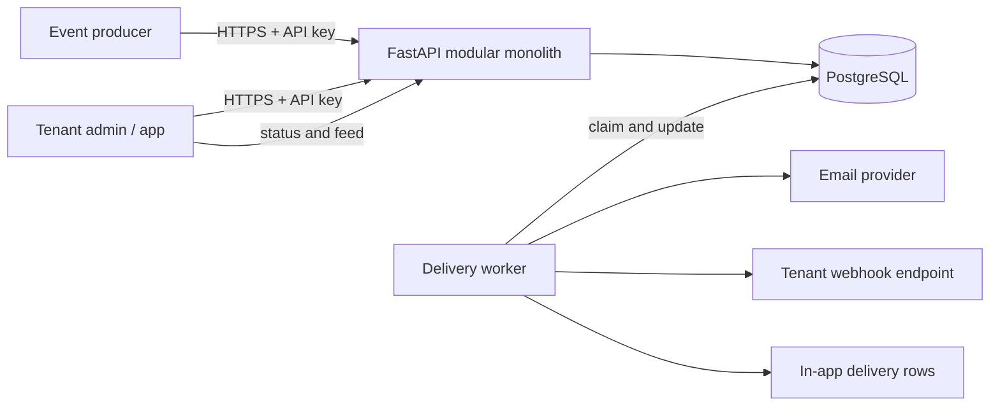

# Architecture

Originally the V0 design; now describes the implemented V1.x system. Load-test
evidence for the worker design is in [benchmarks.md](benchmarks.md).

## Purpose

This is a multi-tenant notification platform. A tenant-owned producer submits an
event; the platform persists it, creates notifications for requested recipients,
and delivers them through email, webhook, or an in-app feed.

V0 is deliberately a modular FastAPI application with PostgreSQL. PostgreSQL is
the durable state store and initial job queue. Redis, Kafka, microservices,
Kubernetes, and cloud infrastructure are deferred until measured needs justify
them.

## Learn before implementation

| Concept | Why it exists | V0 application |
| --- | --- | --- |
| Event-driven design | Producers report facts; delivery reacts later. | Persist a domain event and process delivery asynchronously. |
| Sync vs. async | Provider calls are slow and unreliable. | Acknowledge durable ingestion synchronously; deliver outside the request. |
| Multi-tenancy | Customer data must not cross account boundaries. | Credential-derived `tenant_id` scopes every query and row. |
| At-least-once delivery | A worker can crash after a provider accepts a message. | Retry safely; do not promise exactly once. |
| Idempotency | Producers and workers both retry after uncertain outcomes. | Unique ingestion keys and stable delivery IDs prevent avoidable duplicates. |

## Actors

| Actor | Responsibility |
| --- | --- |
| Tenant | Owns users, events, credentials, endpoints, and notification history. |
| Tenant administrator | Configures recipients and outbound endpoints. |
| Event producer | Tenant application that calls the ingestion API. |
| Notification platform | Validates, persists, fans out, and tracks work. |
| Worker | Claims due deliveries, calls providers, and records results. |
| Provider | Email service, tenant webhook receiver, or in-app store. |
| Recipient | User receiving the notification. |

## Requirements

Functional requirements:

1. Authenticate a producer and derive its tenant.
2. Accept event type, subject, JSON payload, recipients, and requested channels.
3. Make repeated ingestion requests idempotent.
4. Create one notification per recipient and one delivery per requested channel.
5. Support email, webhook, and in-app delivery states.
6. Retry transient failures, retain attempts, and expose status.
7. Enforce tenant isolation for every lookup and mutation.

Initial non-functional assumptions are learning targets, not production claims:

| Area | Assumption / target |
| --- | --- |
| Tenants | Up to 100 active development tenants. |
| Ingestion | 10 events/s sustained; bursts of 50 events/s. |
| Fan-out | Up to 100 recipients × 3 channels (300 deliveries) per event. |
| Acknowledgement | Local p95 below 250 ms while PostgreSQL is healthy. |
| First attempt | Best effort within 30 seconds while workers are healthy. |
| Durability | Acknowledged event and planned delivery rows survive an app restart. |
| Retention | 30-day event/delivery audit baseline; final policy remains a product decision. |

Non-goals: scheduling, batching, subscriptions/preferences, attachments, provider
failover, guaranteed recipient display, ordering guarantees, HA, and cloud
operations. A webhook here is an outbound delivery, not an inbound API.

## High-level architecture

The API and worker may initially run in one process for local development, but
remain separate modules. Workers poll PostgreSQL and claim rows using row locks;
this is the first durable queue and establishes transaction discipline before a
broker is introduced.

## Lifecycle

```mermaid
stateDiagram-v2
  [*] --> received: POST /v1/events
  received --> rejected: invalid or unauthorized
  received --> accepted: event + fan-out committed; 202
  accepted --> pending
  pending --> processing: worker claims
  processing --> delivered: provider accepts
  processing --> pending: transient failure; retry_at set
  processing --> failed: permanent failure or exhausted retries
  delivered --> [*]
  failed --> [*]
  rejected --> [*]
```

1. The producer sends an authenticated request with `Idempotency-Key`.
2. The API validates it, derives `tenant_id`, and hashes normalized content.
3. One PostgreSQL transaction creates the event, notifications, and pending
   deliveries, rendering any active email/in-app templates into each delivery. `(tenant_id, idempotency_key)` prevents duplicate ingestion.
4. Only after commit does the API return `202 Accepted`. A matching retry returns
   the original event; a changed request using the key returns `409`.
5. A worker atomically claims due rows with `FOR UPDATE SKIP LOCKED`, marks them
   `processing`, and leases them. It reclaims expired leases first, then takes due
   rows. These are two index-ordered queries, not one `OR` query. Event,
   user and webhook data are loaded in the same short transaction.
6. It sends each channel payload outside the database transaction, on a thread
   pool (batch 10, concurrency 10 by default). Adapters have no database access.
7. One short completion transaction per batch records an attempt for each delivery
   and marks it delivered, pending with backoff, or failed. Every row
   update is fenced on `attempt_count`, so a worker whose lease was taken over
   cannot overwrite the newer attempt.

## Reliability decisions

The service offers **at-least-once delivery attempts**. If a provider accepts a
message and a worker crashes before its success is stored, that message may be
retried. Losing the message would be worse. The stable `delivery_id` is supplied
as a provider idempotency key when supported and as
`X-Notification-Delivery-Id` to webhooks.

- Producer idempotency is tenant-scoped and compares a request hash.
- Retryable errors use bounded exponential backoff with jitter: 30 seconds, 2
  minutes, 10 minutes, and hourly retries, capped at five attempts. A provider's
  `Retry-After` is honoured when it asks for longer (still capped at 1 h).
- Known permanent errors (bad email, most webhook 4xx responses, any 3xx since
  redirects are not followed) are final; `408` and `429` remain retryable. SMTP
  authentication failures (`530/534/535`) are retryable because they are an
  operator problem, not a bad recipient.
- Expired processing leases can be reclaimed after a worker crash, up to
  `max_attempts`; past that the delivery is failed as `worker_lost`, so a poison
  message cannot crash workers forever. The worker
  refuses to start if `lease < 2 × ceil(batch / concurrency) × provider timeout`,
  because a lease that expires mid-send causes a duplicate.
- `SIGTERM` finishes the in-flight batch and exits; `SIGKILL` is covered by leases.
- Provider diagnostics are truncated and scrubbed before persistence: only status
  codes and short messages, never receiver response bodies or exception traces.
- Lease and schedule times use the database clock, never worker clocks.

## Tenant boundary and modules

The API never takes `tenant_id` from JSON. It gets it from the credential. UUIDs
are identifiers, not authorization: every repository query filters by tenant.
V0.1 enforces this in application code and tests; PostgreSQL row-level security
is a later defense-in-depth requirement before a non-development deployment.
Composite foreign keys (`(tenant_id, parent_id)`) already make cross-tenant links
impossible at the schema level, and cross-tenant lookups return `404` rather than
`403`. Credentials carry a role: `producer` (ingest + read) or `admin`
(also configures users and webhook endpoints).

| Module | Owns | Code |
| --- | --- | --- |
| `api` | HTTP validation, authentication, response mapping | `app/api/` |
| `events` | Event persistence and fan-out orchestration | `app/events/service.py` |
| `notifications` | Retry policy, failure classification, derived status | `app/notifications/` |
| `workers` | Claiming work, concurrency, completion | `app/workers/delivery_worker.py` |
| `providers` | Email (SMTP, fake), webhook (HMAC, SSRF guard), in-app adapters | `app/providers/` |
| `persistence` | Engine/session, models (migrations own the DDL) | `app/db/`, `alembic/versions/` |
| `scripts` | Seed, queue stats, reference webhook receiver | `app/scripts/` |

## Earned-complexity roadmap

| Component | Add only when evidence shows | Benefit |
| --- | --- | --- |
| Redis | Measured caching, rate-limiting, or coordination need. | Speeds a specific transient concern; Postgres remains source of truth. |
| Kafka | Independent consumers need replay/decoupling or the DB queue has measured throughput limits. | Use transactional outbox publishing; consumers remain idempotent. |
| Separate services | Independent scaling/deployment/isolation has a demonstrated benefit. | Replaces the in-process worker boundary. |
| Kubernetes | Multiple services/environments need scheduling and autoscaling. | Replaces manual Compose operations. |

Never dual-write an API request to PostgreSQL and Kafka. When Kafka is warranted,
write event plus outbox row in one transaction, then publish the outbox.

## Validation plan

All items below are implemented (90 tests; CI runs them against PostgreSQL 16).

- [x] Unit-test validation, fan-out, idempotency comparison, transition rules, and
  retry classification. (`tests/test_providers.py`, no database needed)
- [x] Integration-test rollback on invalid recipient, duplicate ingestion without extra
  deliveries, and cross-tenant access denial. Includes a forced-interleaving
  test of the concurrent same-key race.
- [x] Simulate provider success, timeout, `429`, `5xx`, and permanent `4xx` with
  `httpx.MockTransport`, and end to end against a real signed-webhook receiver.
- [x] Simulate a worker crash by expiring a processing lease and assert it is reclaimed
  as another attempt, not a newly created delivery. Plus fencing of the stale
  worker's late completion.
- [x] Establish a baseline over 1,000 events: p50/p95 ingestion time, queue depth,
  p50/p95 delivery lag, retry rate, and terminal failure rate. See
  [benchmarks.md](benchmarks.md): ingest p95 131–233 ms; 4 workers about 1,600–1,700
  deliveries/s; steady-state lag p95 0.52 s.

## Open decisions

1. Allow arbitrary email recipients or only tenant-managed users? (Currently: only
   tenant-managed users.)
2. Which event types need formal JSON schemas beyond generic JSONB payloads?
3. What retention, redaction, deletion, and compliance policy applies to payloads?
4. Which production email provider and credential model should be used?
