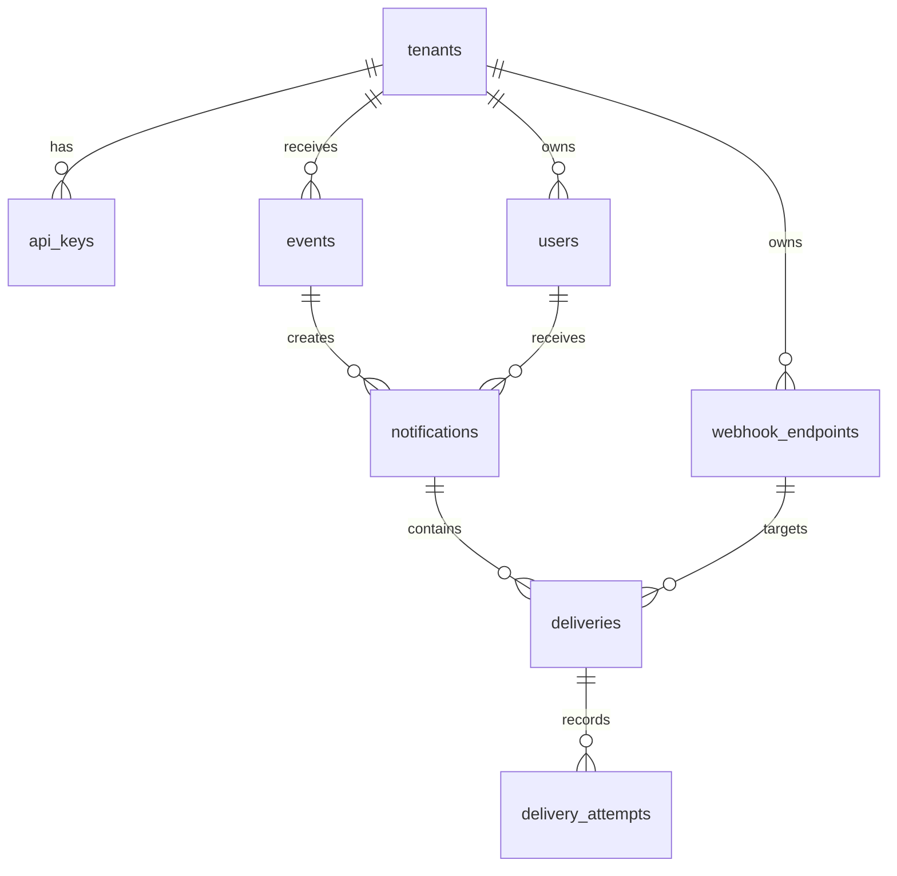

# Database Design

Originally the V0 design; kept in sync with the implemented schema. The
migrations in `alembic/versions/` are the source of truth for DDL. Where the
implementation deviates from the reference DDL below, an "Implementation note"
says how and why.

## Role of PostgreSQL

PostgreSQL is the source of truth for tenant configuration, accepted events,
notification plans, current delivery state, and attempt history. In V0.1 it is
also the durable queue. This puts an accepted event and its planned work in one
transaction, avoiding a premature database/broker dual write.

Use PostgreSQL 16+, UTC `timestamptz`, and Alembic migrations. Prefer UUIDv7
generated in the application for index locality; `gen_random_uuid()` is suitable
for initial development. Never use ORM auto-create in a deployed environment.

Implementation notes:
- Migrations contain **frozen, explicit DDL**. The first versions called
  `Base.metadata.create_all()`, which made old revisions depend on today's models
  and broke fresh databases as soon as a table was added. CI runs
  `upgrade head`, `downgrade base`, `upgrade head`, then `alembic check` to prove
  models and migrations agree.
- Notification IDs are generated in the application (`uuid4`) so the whole
  fan-out is inserted in one batched flush. UUIDv7 remains the preferred upgrade
  once the minimum Python version has `uuid.uuid7()` (3.14).

## Relationship model



| Table | Purpose |
| --- | --- |
| `tenants` | Tenant identity and lifecycle. |
| `api_keys` | Hashed machine credentials and roles. |
| `users` | Tenant-owned recipients and email targets. |
| `webhook_endpoints` | Tenant outbound endpoints; one active default is used in V0. |
| `events` | Idempotently accepted producer events. |
| `notifications` | One logical event notification per recipient. |
| `deliveries` | One channel-specific job and current state. |
| `delivery_attempts` | Append-only provider-attempt audit. |
| `notification_templates` | Tenant-authored email/in-app templates, one per `(event_type, channel)`. |

Every tenant-owned row has `tenant_id`, even where it can be derived from a
parent. This makes scoping and future row-level security clear. Child-table
foreign keys enforce matching tenant and parent IDs.

## Reference DDL

```sql
CREATE EXTENSION IF NOT EXISTS pgcrypto;

CREATE TYPE delivery_channel AS ENUM ('email', 'webhook', 'in_app');
CREATE TYPE delivery_status AS ENUM ('pending', 'processing', 'delivered', 'failed', 'suppressed');
CREATE TYPE api_key_role AS ENUM ('producer', 'admin');

CREATE TABLE tenants (
  id UUID PRIMARY KEY DEFAULT gen_random_uuid(),
  slug TEXT NOT NULL UNIQUE CHECK (slug ~ '^[a-z0-9][a-z0-9-]{1,62}$'),
  name TEXT NOT NULL,
  status TEXT NOT NULL DEFAULT 'active' CHECK (status IN ('active', 'disabled')),
  created_at TIMESTAMPTZ NOT NULL DEFAULT now(),
  updated_at TIMESTAMPTZ NOT NULL DEFAULT now()
);

CREATE TABLE api_keys (
  id UUID PRIMARY KEY DEFAULT gen_random_uuid(),
  tenant_id UUID NOT NULL REFERENCES tenants(id),
  key_prefix TEXT NOT NULL UNIQUE,
  secret_hash TEXT NOT NULL,
  role api_key_role NOT NULL DEFAULT 'producer',
  name TEXT NOT NULL,
  last_used_at TIMESTAMPTZ,
  revoked_at TIMESTAMPTZ,
  expires_at TIMESTAMPTZ,
  created_at TIMESTAMPTZ NOT NULL DEFAULT now(),
  UNIQUE (tenant_id, name)
);

CREATE TABLE users (
  id UUID PRIMARY KEY DEFAULT gen_random_uuid(),
  tenant_id UUID NOT NULL REFERENCES tenants(id),
  external_id TEXT NOT NULL,
  email TEXT,
  active BOOLEAN NOT NULL DEFAULT true,
  created_at TIMESTAMPTZ NOT NULL DEFAULT now(),
  updated_at TIMESTAMPTZ NOT NULL DEFAULT now(),
  UNIQUE (tenant_id, external_id),
  UNIQUE (tenant_id, id)
);

CREATE TABLE webhook_endpoints (
  id UUID PRIMARY KEY DEFAULT gen_random_uuid(),
  tenant_id UUID NOT NULL REFERENCES tenants(id),
  url TEXT NOT NULL,  -- https + public-IP rule enforced in app (see note)
  secret_ciphertext BYTEA NOT NULL,
  active BOOLEAN NOT NULL DEFAULT true,
  is_default BOOLEAN NOT NULL DEFAULT false,
  created_at TIMESTAMPTZ NOT NULL DEFAULT now(),
  updated_at TIMESTAMPTZ NOT NULL DEFAULT now(),
  UNIQUE (tenant_id, id)
);
CREATE UNIQUE INDEX one_active_default_webhook_per_tenant
  ON webhook_endpoints (tenant_id) WHERE active AND is_default;
```

```sql
CREATE TABLE events (
  id UUID PRIMARY KEY DEFAULT gen_random_uuid(),
  tenant_id UUID NOT NULL REFERENCES tenants(id),
  idempotency_key TEXT NOT NULL,
  request_hash TEXT NOT NULL,
  event_type TEXT NOT NULL,
  subject_type TEXT NOT NULL,
  subject_id TEXT NOT NULL,
  payload JSONB NOT NULL,
  metadata JSONB NOT NULL DEFAULT '{}'::jsonb,
  created_at TIMESTAMPTZ NOT NULL DEFAULT now(),
  UNIQUE (tenant_id, idempotency_key),
  UNIQUE (tenant_id, id),
  CHECK (jsonb_typeof(payload) = 'object'),
  CHECK (jsonb_typeof(metadata) = 'object')
);

CREATE TABLE notifications (
  id UUID PRIMARY KEY DEFAULT gen_random_uuid(),
  tenant_id UUID NOT NULL REFERENCES tenants(id),
  event_id UUID NOT NULL,
  user_id UUID NOT NULL,
  created_at TIMESTAMPTZ NOT NULL DEFAULT now(),
  UNIQUE (tenant_id, id),
  UNIQUE (event_id, user_id),
  FOREIGN KEY (tenant_id, event_id) REFERENCES events(tenant_id, id),
  FOREIGN KEY (tenant_id, user_id) REFERENCES users(tenant_id, id)
);

CREATE TABLE deliveries (
  id UUID PRIMARY KEY DEFAULT gen_random_uuid(),
  tenant_id UUID NOT NULL REFERENCES tenants(id),
  notification_id UUID NOT NULL,
  channel delivery_channel NOT NULL,
  status delivery_status NOT NULL DEFAULT 'pending',
  target_snapshot JSONB NOT NULL,
  webhook_endpoint_id UUID,
  attempt_count INTEGER NOT NULL DEFAULT 0 CHECK (attempt_count >= 0),
  max_attempts INTEGER NOT NULL DEFAULT 5 CHECK (max_attempts > 0),
  next_attempt_at TIMESTAMPTZ NOT NULL DEFAULT now(),
  lease_expires_at TIMESTAMPTZ,
  delivered_at TIMESTAMPTZ,
  failed_at TIMESTAMPTZ,
  read_at TIMESTAMPTZ,
  last_error_code TEXT,
  created_at TIMESTAMPTZ NOT NULL DEFAULT now(),
  updated_at TIMESTAMPTZ NOT NULL DEFAULT now(),
  UNIQUE (tenant_id, id),
  UNIQUE (notification_id, channel),
  FOREIGN KEY (tenant_id, notification_id) REFERENCES notifications(tenant_id, id),
  FOREIGN KEY (tenant_id, webhook_endpoint_id) REFERENCES webhook_endpoints(tenant_id, id),
  CHECK (jsonb_typeof(target_snapshot) = 'object'),
  CHECK ((status <> 'delivered') OR delivered_at IS NOT NULL),
  CHECK ((status <> 'failed') OR failed_at IS NOT NULL),
  CHECK ((channel <> 'webhook') OR webhook_endpoint_id IS NOT NULL OR status = 'suppressed'),
  CHECK ((channel = 'webhook') OR webhook_endpoint_id IS NULL)
);

CREATE TABLE delivery_attempts (
  id UUID PRIMARY KEY DEFAULT gen_random_uuid(),
  tenant_id UUID NOT NULL REFERENCES tenants(id),
  delivery_id UUID NOT NULL,
  attempt_number INTEGER NOT NULL CHECK (attempt_number > 0),
  started_at TIMESTAMPTZ NOT NULL DEFAULT now(),
  completed_at TIMESTAMPTZ,
  outcome TEXT NOT NULL CHECK (outcome IN ('success', 'retryable_failure', 'permanent_failure')),
  provider_status_code INTEGER,
  provider_message TEXT,
  created_at TIMESTAMPTZ NOT NULL DEFAULT now(),
  UNIQUE (delivery_id, attempt_number),
  FOREIGN KEY (tenant_id, delivery_id) REFERENCES deliveries(tenant_id, id)
);
```

Implementation notes on the DDL above:
- `webhook_endpoints.url` has no `https://` CHECK in the database. The rule lives in
  `validate_webhook_url()` together with the stronger checks a regex cannot do
  (no credentials, every resolved IP must be public), and it can be relaxed with
  `WEBHOOK_ALLOW_PRIVATE_NETWORKS` so a local receiver works in development.
- The webhook CHECK adds `OR status = 'suppressed'`: when a tenant has no active
  default endpoint, a webhook delivery is recorded as suppressed with no endpoint,
  instead of being impossible to record.
- `secret_ciphertext` is Fernet-encrypted with `WEBHOOK_SECRET_ENCRYPTION_KEY`.
- `'webhook'` was added to `delivery_channel` by a later migration. PostgreSQL
  cannot use a new enum value in the transaction that added it, so that statement
  runs in an autocommit block; enum values cannot be dropped on downgrade.

Templates (added after V1):

```sql
CREATE TABLE notification_templates (
  id UUID PRIMARY KEY DEFAULT gen_random_uuid(),
  tenant_id UUID NOT NULL REFERENCES tenants(id),
  event_type TEXT NOT NULL,
  channel delivery_channel NOT NULL CHECK (channel IN ('email', 'in_app')),
  subject TEXT,                       -- email subject / in-app title
  body TEXT NOT NULL,
  version INTEGER NOT NULL DEFAULT 1 CHECK (version > 0),
  active BOOLEAN NOT NULL DEFAULT true,
  created_at TIMESTAMPTZ NOT NULL DEFAULT now(),
  updated_at TIMESTAMPTZ NOT NULL DEFAULT now(),
  UNIQUE (tenant_id, event_type, channel),   -- also serves the ingestion lookup
  UNIQUE (tenant_id, id),
  CHECK (channel <> 'email' OR subject IS NOT NULL)
);

ALTER TABLE deliveries ADD COLUMN content JSONB
  CHECK (content IS NULL OR jsonb_typeof(content) = 'object');
```

`deliveries.content` holds `{subject, body, template_id, template_version}`,
rendered at ingestion for the same reason `target_snapshot` is: a retry sends what
was decided at planning time, and the audit trail shows exactly which template
version produced it. In SQLAlchemy the column is `JSONB(none_as_null=True)`.
Without that flag, Python `None` is stored as the JSON value `'null'` rather than
SQL `NULL`, and the CHECK above rejects it. The constraint is what caught this bug.

Per-tenant rate limits (added with Redis): `tenants.rate_limit_per_second
NUMERIC` and `tenants.rate_limit_burst INTEGER`, both nullable (NULL = platform
default) with `> 0` checks. The values are read with the credential and cached
alongside it.

Connection pool: each API or worker process holds up to `DB_POOL_SIZE +
DB_MAX_OVERFLOW` connections (10 + 10 by default), with a 5 s `pool_timeout` so an
exhausted pool fails fast instead of hanging requests for SQLAlchemy's default
30 s. The sum across all processes must stay below PostgreSQL's
`max_connections` (100 by default). Past roughly that many processes, put PgBouncer
in front.

`target_snapshot` records the minimum safe target at planning time. Changing a
user email or endpoint later does not change audit history or redirect retries.
Examples: email `{ "email": "..." }`; in-app `{ "user_id": "..." }`; webhook
`{ "url": "..." }`. Webhook signing secrets are never snapshots. V0 uses a
tenant's active default webhook endpoint; per-user or multi-endpoint routing is a
deliberate later product addition.

## Required indexes

```sql
CREATE INDEX idx_api_keys_active ON api_keys (key_prefix) WHERE revoked_at IS NULL;
CREATE INDEX idx_events_tenant_created ON events (tenant_id, created_at DESC);
CREATE INDEX idx_notifications_tenant_created ON notifications (tenant_id, created_at DESC);
CREATE INDEX idx_notifications_user_created ON notifications (tenant_id, user_id, created_at DESC);
CREATE INDEX idx_deliveries_due ON deliveries (next_attempt_at, id) WHERE status = 'pending';
CREATE INDEX idx_deliveries_expired_lease ON deliveries (lease_expires_at, id) WHERE status = 'processing';
CREATE INDEX idx_deliveries_notification ON deliveries (tenant_id, notification_id);
CREATE INDEX idx_attempts_delivery ON delivery_attempts (tenant_id, delivery_id, attempt_number);
```

Do not create a generic GIN index on event payloads. Add a targeted index only
after an implemented and measured query requires it.

## Transactions

### Ingestion

1. Authenticate, derive tenant, validate the full request, and calculate the hash.
2. Insert the event. On unique-key conflict, load that tenant's existing event:
   return it for matching hash, otherwise return `409`.
3. Verify each recipient, resolve channel targets, then insert every notification
   and delivery in the same transaction. A valid recipient with no usable channel
   target receives a `suppressed` delivery rather than being silently redirected.
4. Commit and return `202`. If fan-out cannot be completely planned, roll back all
   rows: an accepted event always has a complete audit trail.

### Worker claim and completion

Claim a bounded batch with `FOR UPDATE SKIP LOCKED`, commit, call providers, then
make a short completion transaction. Never hold a database transaction during a
provider HTTP call.

The original design used one claim query with
`WHERE (pending AND due) OR (processing AND lease expired)`. `EXPLAIN` showed that
the `OR` makes PostgreSQL BitmapOr both partial indexes, fetch and **sort every
due row**, and only then apply `LIMIT`, so each claim cost O(backlog). The
implementation runs two statements in one transaction, one per partial index.
Each is an ordered index scan that stops after `:limit` unlocked rows:

```sql
-- 1) crashed workers' rows first (idx_deliveries_expired_lease), then
-- 2) due rows to fill the batch (idx_deliveries_due)
WITH picked AS (
  SELECT id FROM deliveries
  WHERE status = 'pending' AND next_attempt_at <= now()     -- or: 'processing' AND lease_expires_at < now()
  ORDER BY next_attempt_at, id                              -- or: lease_expires_at, id
  LIMIT :limit
  FOR UPDATE SKIP LOCKED
)
UPDATE deliveries d
SET status = 'processing', attempt_count = d.attempt_count + 1,
    lease_expires_at = now() + make_interval(secs => :lease_seconds), updated_at = now()
FROM picked WHERE d.id = picked.id
RETURNING d.id;
```

All times come from the database's `now()`, so workers with skewed clocks never
disagree about lease expiry.

Completion appends `delivery_attempts` and moves each row to `delivered`,
`pending` with a future `next_attempt_at`, or `failed`. Each row's `UPDATE` is
**fenced**: `WHERE status = 'processing' AND attempt_count = <claimed attempt>`. A
worker whose lease expired and was re-claimed matches zero rows, and its late
result is dropped. Load testing showed one commit per delivery
saturating the WAL-write lock, so a whole batch's outcomes are written in **one
transaction**, falling back to one commit per outcome if the batch fails.
The provider-call gap is why delivery is at-least-once and requires stable
provider keys.

### Transactional outbox (Kafka mode)

```sql
CREATE TABLE outbox (
  id BIGSERIAL PRIMARY KEY,
  topic TEXT NOT NULL,
  message_key TEXT NOT NULL,
  payload JSONB NOT NULL CHECK (jsonb_typeof(payload) = 'object'),
  aggregate_id UUID NOT NULL,                       -- the delivery
  available_at TIMESTAMPTZ NOT NULL DEFAULT now(),  -- future for retries
  created_at TIMESTAMPTZ NOT NULL DEFAULT now(),
  publish_attempts INTEGER NOT NULL DEFAULT 0,
  last_error TEXT
);
CREATE INDEX idx_outbox_available ON outbox (available_at, id);
CREATE INDEX idx_outbox_aggregate ON outbox (aggregate_id);
```

- **Written:** in the ingestion transaction (one row per pending delivery), in
  the completion transaction for each retry (`available_at = next_attempt_at`),
  and by the relay's sweeper for expired leases.
- **Relay:** `SELECT … WHERE available_at <= now() ORDER BY available_at, id LIMIT n
  FOR UPDATE SKIP LOCKED`, produce, wait for acks, then `DELETE` the acked ids and
  commit. Failed rows get `publish_attempts + 1`, `last_error`, and
  `available_at = now() + min(2^attempts, 300) s`.
- It's a generic outbox (topic, key, payload), so other domain events can reuse it.
- **Churn:** every row is inserted and deleted once, so it needs the same vacuum
  attention as `deliveries`. A growing `publish_attempts` is an alert
  (`python -m app.scripts.stats` reports failing rows).

Consumer claim (fenced, so duplicate messages are no-ops):

```sql
UPDATE deliveries
SET status = 'processing', attempt_count = attempt_count + 1,
    lease_expires_at = now() + make_interval(secs => :lease_seconds), updated_at = now()
WHERE id = ANY(:ids) AND status = 'pending' AND next_attempt_at <= now()
RETURNING id;
```

## State transitions

| From | To | Condition |
| --- | --- | --- |
| `pending` | `processing` | Worker claims eligible work. |
| `processing` | `delivered` | Provider accepts send or in-app item is available. |
| `processing` | `pending` | Retryable error with attempts remaining. |
| `processing` | `failed` | Permanent error or attempts exhausted. |
| `pending` | `suppressed` | Target unavailable or preference blocks send. |
| `processing` | `processing` | Expired lease is reclaimed and attempt count increases (only while `attempt_count < max_attempts`). |
| `processing` | `failed` | Lease expired with no attempts left (`last_error_code = 'worker_lost'`, poison-message guard). |
| `processing` | `pending` | Circuit open for the target: deferred, `attempt_count - 1` (the claim is handed back, no attempt row). |
| `failed` | `pending` | Admin redrive: `max_attempts = attempt_count + extra`, audit row in `delivery_redrives`. |

Dead-letter support:

```sql
CREATE INDEX idx_deliveries_dead_letters ON deliveries (tenant_id, failed_at DESC, id DESC)
  WHERE status = 'failed';

CREATE TABLE delivery_redrives (          -- one row per manual replay
  id UUID PRIMARY KEY DEFAULT gen_random_uuid(),
  tenant_id UUID NOT NULL,
  delivery_id UUID NOT NULL,
  api_key_id UUID NOT NULL REFERENCES api_keys(id),
  reason TEXT,
  previous_attempt_count INTEGER NOT NULL,
  previous_error_code TEXT,
  extra_attempts INTEGER NOT NULL CHECK (extra_attempts > 0),
  created_at TIMESTAMPTZ NOT NULL DEFAULT now(),
  FOREIGN KEY (tenant_id, delivery_id) REFERENCES deliveries(tenant_id, id)
);
```

Redrive locks the target rows with `FOR UPDATE SKIP LOCKED` and requires
`status = 'failed'`, so concurrent redrives can never enqueue a delivery twice.

Note that `suppressed` is decided at **planning time** (the delivery is inserted
as suppressed), not by a worker transition. `delivery_attempts.outcome` records
what the provider said. A `failed` delivery whose last attempt is
`retryable_failure` means retries were exhausted.

`delivered`, `failed`, and `suppressed` are terminal. Manual redrive is a future
administrative feature and must preserve attempt history.

## Security, operations, and measurements

- Store only a hash or verifier of API-key secrets; reveal a generated secret once.
  Implementation note: new keys use SHA-256, not a slow KDF. The secrets are 256
  random bits, so brute force is infeasible even against a fast hash, and scrypt
  measured 35 ms of CPU per request (about 28 req/s per core). Legacy scrypt hashes
  still verify. Lookup is by the indexed public `key_prefix`; comparison
  is constant-time.
- Encrypt webhook secrets; never return, log, snapshot, or include them in errors.
- Bound and redact provider diagnostics. Payloads may hold personal data, so logs,
  database access, retention, and deletion need an explicit policy before regulated use.
- Before non-development use, add PostgreSQL row-level security based on a validated
  per-transaction tenant setting; design connection-pool reset and DB privileges first.

Record ingestion latency, due queue depth, p50/p95/p99 delivery lag by channel,
retry and terminal-failure rate by provider, and expired-lease recovery count.
These measurements are the evidence for adding Redis, Kafka, or separate workers.
`python -m app.scripts.stats` prints them (queue depth, waiting-on-backoff,
in-flight, expired leases, oldest due age, per-channel lag p50/p95/p99, retry and
terminal-failure rates). Results from the load test are in
[benchmarks.md](benchmarks.md).

`deliveries` is a churny queue table: every claim and completion updates a row,
leaving dead tuples and dead partial-index entries (11,400 were observed on an
empty queue after a load test). Before production, lower
`autovacuum_vacuum_scale_factor` for this table rather than relying on the 20%
default.

```sql
SELECT channel, status, count(*)
FROM deliveries
WHERE created_at >= now() - interval '1 hour'
GROUP BY channel, status
ORDER BY channel, status;
```

## Trade-offs

- JSONB permits heterogeneous producer events without premature schemas; it trades
  off database-level validation and free-form querying.
- A PostgreSQL queue is transactionally coupled and simple; polling limits
  throughput, so replace it only when measurement justifies a broker.
- Append-only attempts cost storage but make failures and retries explainable.
- Target snapshots favor audit-safe retry behavior over automatically applying a
  later address change; “use current address” requires a future explicit policy.
