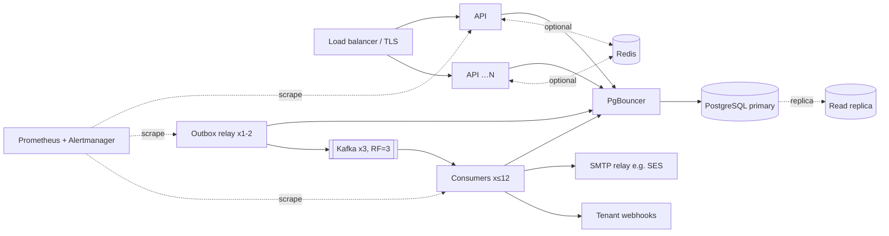

# Deployment

How to run this platform beyond a laptop. The Docker Compose stack is the
reference for *what* runs. This guide covers *how* to run it safely: topology,
release process, configuration, sizing, and the checklist of things that differ
from local development.

## Production topology



| Component | Instances | Stateful? | Notes |
| --- | --- | --- | --- |
| API | 2+ behind a load balancer | No | Scales horizontally; readiness on `/readyz`, liveness on `/healthz` |
| Migrations | 1 job per release | — | Runs before the new API and workers start (see Release process) |
| Outbox relay | 1–2 | No | Several are safe (`SKIP LOCKED`); one is usually enough (it published 6,000 rows in under 1 s) |
| Delivery consumers | 1–12 | No | At most one per partition per group (12 partitions) |
| PostgreSQL | Managed, primary plus replica | **Yes, source of truth** | Point-in-time recovery on; see sizing |
| PgBouncer | 1–2 | No | Transaction pooling once processes × pool size approaches `max_connections` |
| Redis | Managed or 1 node | No (rebuildable) | Optional: cache, rate limits, circuit breakers. No persistence needed |
| Kafka | 3 brokers or managed (MSK, Confluent) | Yes | Only for `DISPATCH_MODE=kafka`. RF=3, `min.insync.replicas=2` |

**Smallest sensible deployment:** `DISPATCH_MODE=postgres` with 2 API instances,
2 polling workers, managed PostgreSQL and, optionally, Redis. Measured, Kafka
doesn't add throughput while Postgres is the system of record (see
[benchmarks.md](benchmarks.md#kafka-vs-postgres-dispatch-plan-step-3)). Add it
for outage isolation, replay, or more consumers of the stream.

## Release process

1. **Build one image** (the `Dockerfile`). API, workers, relay and migrations are
   the same artifact with different commands, so there's no version skew between them.
2. **Run migrations as a one-shot job** (`alembic upgrade head`) and wait for
   success. Never migrate on application startup: N replicas would race, and a
   failed migration would crash-loop all of them.
3. **Roll out the API** (rolling update gated on `/readyz`), then workers and relay.
4. **Graceful shutdown:** workers finish their in-flight batch on SIGTERM. Give
   them 30 s (`stop_grace_period` or `terminationGracePeriodSeconds`). Kafka
   consumers leave the group cleanly, so partitions move immediately.

**Zero-downtime migrations** follow expand/contract: add nullable columns and
new tables first, deploy code that writes both shapes, backfill, then remove the
old shape in a later release. Every migration in this repo is additive.
Downgrades exist but can't remove PostgreSQL enum values (`'webhook'`).

## Configuration reference

| Variable | Default | Production |
| --- | --- | --- |
| `DATABASE_URL` | — (required) | Through PgBouncer; credentials from a secret manager |
| `DB_POOL_SIZE` / `DB_MAX_OVERFLOW` / `DB_POOL_TIMEOUT_SECONDS` | 10 / 10 / 5 | Keep `processes × (size + overflow) < max_connections`, or use PgBouncer |
| `WEBHOOK_SECRET_ENCRYPTION_KEY` | — (required for webhooks) | **Generate a new Fernet key**; never reuse the dev key in `.env.example` |
| `WEBHOOK_ALLOW_PRIVATE_NETWORKS` | false | **Must be `false`** (SSRF protection) |
| `WEBHOOK_TIMEOUT_SECONDS` | 10 | Keep the worker lease above 2 × batch / concurrency × timeout (enforced at startup) |
| `EMAIL_PROVIDER` | `fake` | `smtp` |
| `SMTP_HOST` / `SMTP_PORT` / `SMTP_USERNAME` / `SMTP_PASSWORD` / `SMTP_STARTTLS` / `SMTP_TIMEOUT_SECONDS` | localhost / 1025 / — / — / false / 10 | Your relay, e.g. SES on 587 with `SMTP_STARTTLS=true` |
| `EMAIL_FROM` | `notifications@example.test` | A verified sender domain (SPF, DKIM, DMARC) |
| `REDIS_URL` | unset (no Redis) | Optional. Unset disables the cache, rate limits and circuit breakers |
| `REDIS_TIMEOUT_SECONDS` | 0.25 | Above Redis's measured *tail* latency in your environment; 50 ms tripped on a healthy Redis under load |
| `CACHE_TTL_SECONDS` | 60 | Also the worst-case delay for a key revoked directly in SQL |
| `RATE_LIMIT_PER_SECOND` / `RATE_LIMIT_BURST` | 50 / 100 | Per-tenant overrides: `tenants.rate_limit_per_second/_burst` |
| `CIRCUIT_FAILURE_THRESHOLD` / `CIRCUIT_COOLDOWN_SECONDS` / `CIRCUIT_MAX_COOLDOWN_SECONDS` | 5 / 30 / 300 | — |
| `DISPATCH_MODE` | `postgres` | `postgres`, or `kafka` (then run the relay and consumers) |
| `KAFKA_BOOTSTRAP_SERVERS` | `localhost:9092` | The broker list |
| `KAFKA_DELIVERY_TOPIC` / `KAFKA_CONSUMER_GROUP` | `notification.deliveries.v1` / `notification-delivery-workers` | Override per environment if clusters are shared |
| `LOG_FORMAT` / `LOG_LEVEL` | `text` / `INFO` | `json` / `INFO` |
| `METRICS_PORT` | unset | Set for workers and relay so Prometheus can scrape them |
| `PROMETHEUS_MULTIPROC_DIR` | unset | **Required** when running `uvicorn --workers N`; an empty directory at start |

Create Kafka topics explicitly (auto-creation should be off):

```sh
python -m app.scripts.kafka_topics --replication-factor 3
```

Bootstrap a tenant and its first keys with `python -m app.scripts.seed`
(`SEED_TENANT_SLUG`, `SEED_TENANT_NAME`). Keys are printed once; only hashes are stored.

## Sizing from measurements

These come from a single 8-core laptop ([benchmarks.md](benchmarks.md)), so treat
them as relative guidance, not capacity promises.

| Resource | Measured | Guidance |
| --- | --- | --- |
| API process | 138–155 events/s alone (3 recipients × 2 channels); 4 processes → 213–229 on a saturated host | Start with 2 instances; add more when `POST /v1/events` p95 approaches 250 ms |
| Polling worker | about 400–535 deliveries/s per process; 4 → about 1,600–1,700/s | Scale on `deliveries_oldest_due_seconds` |
| PostgreSQL | The first shared bottleneck (commit throughput) | Batched completion is in; next: a bigger instance, then bulk completion SQL |
| Worst-case fan-out | 100 recipients × 2 channels at p95 229 ms ingest | Sustained 10 events/s of such fan-out needs about 2,000 deliveries/s: more workers than measured here |

## Production checklist

**Security**
- [ ] New `WEBHOOK_SECRET_ENCRYPTION_KEY` from a secret manager; plan rotation (it is a single key today, and `MultiFernet` is the upgrade path)
- [ ] `WEBHOOK_ALLOW_PRIVATE_NETWORKS=false`
- [ ] TLS at the load balancer; HTTPS only
- [ ] A database role without DDL rights for the app; a separate role for migrations
- [ ] Bootstrap keys rotated after first use; `api_keys.expires_at` set where possible

**Reliability**
- [ ] Kafka topics with RF=3, `min.insync.replicas=2` (Kafka mode)
- [ ] PostgreSQL point-in-time recovery, and a tested restore
- [ ] Lower `autovacuum_vacuum_scale_factor` on `deliveries` and `outbox` (high-churn queue tables)
- [ ] Alertmanager routes for `observability/alerts.yml` (page vs ticket vs info)
- [ ] JSON logs shipped to a log store (searchable by `request_id`, `tenant_id`)

**Known gaps to close before regulated or large-scale use**
- [ ] Data retention: partition `events`, `deliveries` and `delivery_attempts` by time and drop old partitions
- [ ] Row-level security as defence in depth for tenant isolation
- [ ] Pin the resolved IP for webhook connections (DNS-rebinding gap in the SSRF guard)
- [ ] Fair *delivery* scheduling across tenants (ingestion is rate limited; the queue is FIFO)
- [ ] Lease heartbeats if crash recovery (about 70 s for in-flight work) is too slow
