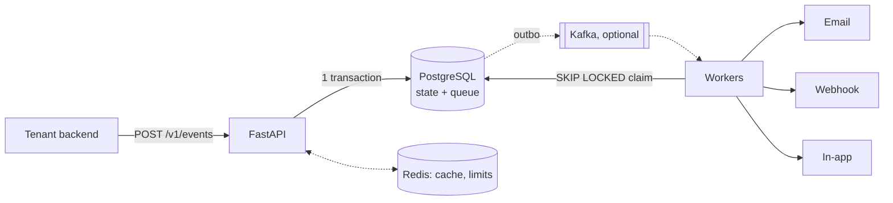

# Scaling a Notification Platform: Bottlenecks, Experiments, and Architecture Changes

*An engineering write-up of building a multi-tenant notification platform the
measured way. The detailed numbers are in [benchmarks.md](benchmarks.md) and
[failure-experiments.md](failure-experiments.md).*

## TL;DR

- I built a multi-tenant notification service (email, signed webhooks, in-app)
  on FastAPI and PostgreSQL, then added Redis and Kafka only when I could state
  what each one was for.
- The biggest throughput win was **one commit per batch instead of one per
  delivery** (2× worker throughput). I found it by sampling PostgreSQL *wait
  events*, after two plausible fixes did nothing.
- **Kafka didn't make it faster.** With Postgres as the system of record, the
  ceiling is state writes, which Kafka doesn't remove. I had written down the
  opposite beforehand, and I corrected the docs.
- **Breaking things on purpose** found bugs no test had: plain-text 500s during a
  database outage, a relay that crash-looped, and a consumer that silently
  dropped poison messages.
- **The metrics lied twice** (a p95 off by 2.5× and a lag gauge that vanished
  when consumers died), and **my load generator was the bottleneck** for longer
  than I'd like to admit.

## The system

A tenant's backend posts an event: "order 42 was paid, tell user Ada by email,
webhook and in-app". The API authenticates the tenant from its API key,
validates the request, and in **one PostgreSQL transaction** writes the event,
one notification per recipient, and one delivery job per channel. Only after
commit does it return `202 Accepted`. Workers claim due jobs with
`SELECT … FOR UPDATE SKIP LOCKED`, call the providers *outside* any transaction,
and record the outcome.

The reliability core: idempotency keys with a request hash, at-least-once
delivery with a stable delivery ID, leases with a fencing token
(`attempt_count`) so a slow worker can't overwrite a newer attempt, retry
classification with exponential backoff and jitter, and dead-letter replay.

The rule I held myself to: **every component needs a reason, and every
performance claim needs a number.**

## 1. Workers didn't scale, and the first two fixes were wrong

Four polling workers drained a 6,000-delivery backlog only about 1.6× faster than one.

- **Guess 1: fsync.** I turned off `synchronous_commit`: no change.
- **Guess 2: ORM overhead.** I rewrote completion as a single
  `UPDATE … RETURNING`: no change (I kept it anyway, because it's simpler).
- **Measured.** Sampling `pg_stat_activity` showed about two-thirds of active
  database time waiting on `LWLock:WALWrite` and `IO:WALSync` at `COMMIT`. Six
  thousand tiny commits were contending on the WAL-write lock, *whether or not
  anyone waited for fsync*, which is why guess 1 did nothing.

The fix was to record a whole batch's outcomes in **one transaction**, still
fenced per row, with a fallback to per-row commits if one row fails. Four
workers went from 824 to about **1,650 deliveries/s**. Along the way `EXPLAIN`
showed the claim query sorting the *entire* backlog because of an `OR` across two
partial indexes. Splitting it removed an O(backlog) cliff but barely moved
throughput. **Fixing an inefficiency is not the same as fixing the bottleneck.**

## 2. A security default that cost 35 ms per request

The design doc said "store API keys with a slow hash". scrypt took **35 ms of
CPU per authenticated request**, which caps a core at about 28 requests/s. But
slow KDFs exist to protect *low-entropy human passwords*. These keys are 256
random bits, so a fast hash can't be brute-forced either. I moved new keys to
SHA-256 (constant-time compare, indexed public prefix), and old keys still verify.
**Understand why a rule exists before applying it.**

## 3. Redis: my prediction was wrong, and so was the hit rate

Redis earned its place with two jobs Postgres does badly per request:
- a shared, atomic **per-tenant rate limiter** (GCRA in one Lua script, on
  Redis's clock), which closed the "one tenant fills the queue" gap;
- **cache-aside** for credentials and templates.

I recorded a baseline first and wrote down a prediction: caching three
sub-millisecond local queries wouldn't move latency. Round trips per ingest fell
from 9 to 6, and per authenticated read from 3 to 1. Then throughput rose
**about 15%** and p50 fell from 108 to about 93 ms. The prediction was wrong because
each skipped query also skips ORM work, and the API was CPU-bound.

Redis's `INFO` reported an **83%** hit rate; isolating the cache gave **99.5%**.
Rate-limiter keys, which miss by design, were mixed into the server-wide
counter. Every Redis call fails open behind a 50 ms timeout and a circuit
breaker. With Redis stopped mid-traffic, 60 of 60 requests were accepted with no
latency increase.

## 4. Kafka was slower, then my justification turned out wrong

Kafka arrived through a **transactional outbox**: the outbox row is written in
the same transaction as the deliveries, and a relay publishes it, so there's
never a dual write. Messages are pointers (`delivery_id`) that consumers claim in
Postgres with `UPDATE … WHERE status = 'pending'`. That makes duplicates
harmless: effectively-once from at-least-once.

The first benchmark was humbling: Kafka mode was **slower everywhere**. Four
findings, in order:

1. **Partition skew.** I keyed messages by `tenant:user` for per-recipient
   ordering. The 3-recipient test used **3 of 12 partitions**. Ordering was a
   non-goal anyway, so I keyed by `delivery_id`.
2. **Batch-fill wait.** `consume(50, timeout=1.0)` waits up to a second to *fill*
   a batch. A two-phase fetch cut steady-state lag p95 from 3.27 s to **0.49 s**.
3. **Eager rebalancing.** Consumers joining one by one idled the group for about
   2 s. Cooperative-sticky assignment fixed that.
4. **The honest one.** Warm, Kafka drained a backlog at **1,240/s** against
   polling's 1,300–1,460, with equal steady-state latency. Each delivery still
   needs the same Postgres writes, plus an outbox insert and delete.

I had written that the Postgres queue's ceiling would justify Kafka. **That was
false, and the docs now say so.** What Kafka actually bought: ingestion that
keeps working while the broker is down (verified live: 20/20 accepted, all
delivered after recovery), push instead of polling, replay, and room for more
consumer groups.

The relay had its own lesson. It published in all-or-nothing batches, so one
outbox row addressed to a deleted topic **stopped all publishing**. Each row now
gets its own verdict and backoff.

## 5. Breaking it on purpose

Stopping PostgreSQL before writing any reliability code found three problems:
- the API answered with **plain-text 500s**, breaking its own error contract;
- `/healthz` stayed green, so nothing would take the instance out of rotation;
- the relay **crash-looped** on Docker restarts.

Now an outage returns `503` with `Retry-After` (and clients retry with the same
idempotency key). `/readyz` fails while liveness stays green, so an orchestrator
doesn't restart every healthy process, and workers back off in-process.

**Circuit breakers** are per webhook endpoint, shared through Redis, with a
single half-open probe. While open, deliveries are deferred *without spending a
retry*. Against a black-hole endpoint (accepts connections, never answers), a
healthy tenant's wait fell from **41 s to 11 s**, and requests into the dead
endpoint from 46 to 10. My first result said 21 s. The worker log showed a
*different* endpoint's circuit moving: leftover rows from the previous run were
at the head of the queue. The experiment now refuses to run unless the queue is
empty.

A SIGKILLed consumer mid-batch lost nothing (6,000/6,000 delivered), but the
in-flight work waited about 70 s, which made it visible that **lease length is
crash-recovery latency**. A test also caught the consumer *committing past* a
poison message when no dead-letter producer was configured. A default must never
mean "drop data".

## 6. When the metrics lie

Observability came last and immediately found its own bugs, because I
cross-checked every metric against SQL ground truth once:

- **End-to-end p95 read 28 s; SQL said 11 s.** The histogram buckets jumped from
  10 s to 30 s, and `histogram_quantile` interpolates inside a bucket. With dense
  buckets around the SLO the two agreed (19.33 vs 19.44 s).
- **The first dead letter would never have alerted.** Labelled counters don't
  exist until first use, and a series that appears at 1 is invisible to
  `increase()`. Now every known label combination starts at zero.
- **Consumer lag vanished when consumers were idle, or dead.** Lag is now
  measured by the relay from outside the group. With every consumer stopped it
  read 1,800 and stayed visible.
- **`uvicorn --workers 2` halved every counter**, because each scrape saw one
  process. That's what `PROMETHEUS_MULTIPROC_DIR` is for.

And the scale experiment: adding API processes didn't raise throughput. CPU
wasn't saturated, Postgres was idle by wait events, and connections were evenly
spread. The load generator held **12 of its 40 connections**. With a
multi-process generator, 1 → 2 → 4 API processes gave 138–155 → 179–180 →
213–229 events/s, until the laptop's CPU was saturated (0.1% idle). Every
earlier "API throughput" number had partly measured the load generator.

## What I'd do next

- Partition the deliveries tables by time, for retention and vacuum.
- Fair scheduling of *deliveries* across tenants (ingestion is already limited).
- Lease heartbeats, for fast crash recovery that is also safe for slow sends.
- Pin the resolved IP for webhook connections (DNS-rebinding gap).
- Measure scaling on separate hosts. One laptop can't tell API limits from host limits.

## Lessons

1. **Measure before optimizing, and write the prediction down.** Two of my
   "obvious" fixes did nothing, and one confident prediction was wrong.
2. **Wait events tell you what the database waits on.** CPU graphs only show that it's busy.
3. **Make the queue's failure modes explicit.** Leases plus fencing tokens,
   idempotent consumers, per-item verdicts, and poison handling were all needed,
   and each was found by a test or an experiment.
4. **Break it before you trust it.** Each outage bug was invisible until forced.
5. **Cross-check metrics against ground truth once.** Buckets, absent series and
   self-reported health can all lie.
6. **Prove the load generator can drive the load** before believing a throughput number.
7. **Report results that contradict you.** The Kafka correction is the most
   useful part of this project.
